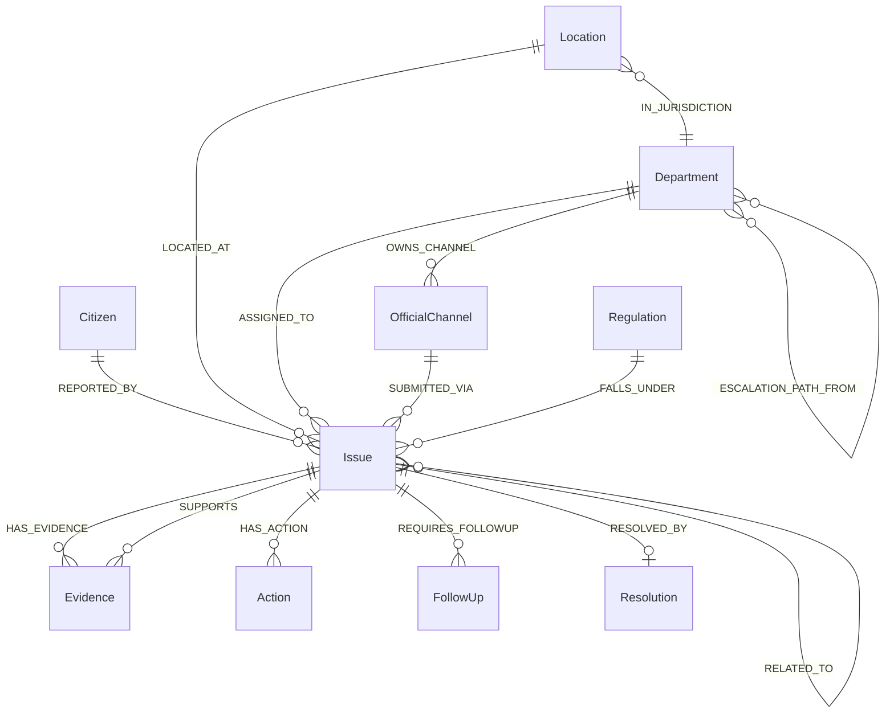

# Civic knowledge graph schema

Single source of truth for citi assist cases. Store typed entities and relationships (triples). A simple JSON document plus per-issue files is enough; Neo4j-style labels also work.

## Entity types

| Type | Purpose |
|------|---------|
| Citizen | Minimal reporter identity needed for the case (consent-aware) |
| Issue | The complaint or request under management |
| Location | Where the issue is (address, intersection, neighbourhood, jurisdiction) |
| Department | Owning public body (municipal, regional, provincial, federal) |
| OfficialChannel | Verified contact method owned by a Department |
| Regulation | Confirmed bylaw, statute, or policy (only when verified) |
| Evidence | Photo, quote, map, news item, official page, prior report |
| Action | Submission, call, letter, status check, escalation |
| FollowUp | Scheduled check with due date and owner |
| Resolution | Closure record and outcome |

## Core relationships

```text
(Issue)-[:REPORTED_BY]->(Citizen)
(Issue)-[:LOCATED_AT]->(Location)
(Issue)-[:FALLS_UNDER]->(Regulation)
(Issue)-[:ASSIGNED_TO]->(Department)
(Issue)-[:SUBMITTED_VIA]->(OfficialChannel)
(Issue)-[:HAS_EVIDENCE]->(Evidence)
(Issue)-[:HAS_ACTION]->(Action)
(Issue)-[:REQUIRES_FOLLOWUP]->(FollowUp)
(Issue)-[:RESOLVED_BY]->(Resolution)
(Department)-[:OWNS_CHANNEL]->(OfficialChannel)
(Evidence)-[:SUPPORTS]->(Issue)
(Issue)-[:RELATED_TO]->(Issue)
(Location)-[:IN_JURISDICTION]->(Department)
(Department)-[:ESCALATION_PATH_FROM]->(Department)
```

Note on escalation: `ESCALATION_PATH_FROM` points from the higher body to the lower body (example: Ombudsperson `ESCALATION_PATH_FROM` Customer Service Centre).

## OfficialChannel fields

| Field | Meaning |
|-------|---------|
| method | phone, email, app, form, mail, portal, ... |
| value | Number, address, URL, or app name |
| source_url | Official page used for verification |
| verified_on | Date checked (YYYY-MM-DD) |
| status | `verified`, `corrected`, or `unverified` |

Do not invent values. Re-check official pages before formal submissions.

## Default municipal escalation

1. Owning department (example: Engineering, Licensing)
2. Customer Service Centre
3. Mayor and Council via Legislative Services
4. BC Ombudsperson (after local complaint processes have been tried)

## Mermaid overview



## Graph engineering loop

1. **Ingestion** - citizen message, photos, links, prior history
2. **Extraction** - entities and relationships with supporting quotes
3. **Resolution** - deduplicate issues and department aliases
4. **Storage** - persist graph + case artifacts
5. **Retrieval** - entity lookup, path traversal, temporal and similar-issue search
6. **Agent** - plan, query, tool use, next action
7. **Verification** - every claim grounded; flag contradictions; confidence
8. **Update** - write new facts, timestamp superseded ones, schedule maintenance

## Seed vs live data

- `seed-departments-channels.json` ships public Departments, OfficialChannels, and jurisdiction Locations only.
- Citizen, Issue, Evidence, Action, FollowUp, Resolution, and Regulation nodes are created at intake.
- Real case folders (`issues/`, `evidence/`) stay local and are gitignored in this proof-of-work layout.
